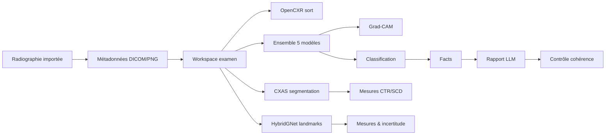

# Architecture

## Vue globale

```
                        AImaging
                           │
          ┌────────────────┼───────────────┐
          │                │               │
        Client           Server          Scripts
          │                │               │
          │                │               │
          └────────────────┴───────────────┘
                           │
                        Supabase
```

Trois composants, un stockage Supabase.

## Responsabilités

| Composant | Rôle |
|---|---|
| `client/` | Application web React (édition, visualisation, interface IA). |
| `server/` | API FastAPI : classification, anatomie, DICOM, agent IA, rapports. |
| `scripts/` | Inférence standalone, prétraitement, entraînement. |
| Supabase | Auth, persistance PostgreSQL, Storage. |

## Communication

- Le client appelle l'API serveur en HTTP (port 8000), base URL configurable
  via `VITE_API_BASE_URL`.
- Le serveur expose des endpoints JSON. Les images sont envoyées en
  `multipart/form-data` ou référencées par identifiant d'examen.
- Le serveur délègue certaines inférences lourdes à des services distants :
  - opencxr (tri + normalisation CXR) : microservice Python 3.12, port 8011 ;
  - pathologies « Neuro » : Space Hugging Face public (YOLOv8 + DenseNet) ;
  - reconstruction 3D : backend local CPU ou service distant GPU.
- Le client persiste les données métier dans Supabase (Auth, tables, Storage).

## Flux de données principal (radiographie)



## Persistance

- PostgreSQL (via Supabase) : profil utilisateur, espaces de travail, examens,
  images, annotations, résultats, mesures, rapports, organisations, modèles de
  rapports. Protégé par RLS basé sur `auth.uid()`.
- Supabase Storage : fichiers d'images (buckets).
- `localStorage` (client) : préférences UI, cache local, historique récent.
  La source de vérité des données métier reste Supabase.
- Runtime serveur (mémoire) : sessions workspace temporaires, journal d'audit,
  configuration des backends distants (`.runtime/`).

## Fichiers lourds

Les PNG rendus et les masks sont transmis en data-URL dans les réponses. Les
DICOM bruts ne sont jamais persistés côté serveur ni envoyés au LLM.

## Runtime

| Processus | Technologie | Port |
|---|---|---|
| Serveur principal | FastAPI / Uvicorn | 8000 |
| Microservice opencxr | FastAPI / Uvicorn (venv312) | 8011 |
| Client | Vite | 5173 |

## Dépendances externes clés

- Google Gemini (génération de rapports, agent de workspace).
- Supabase (auth, PostgreSQL, Storage).
- TensorFlow (via le microservice opencxr uniquement).
- PyTorch / torchvision (classification, anatomie, mesures).