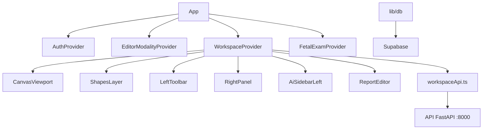

# Client

Application web React + TypeScript + Vite. C'est l'interface de l'éditeur
médical : affichage des images, annotations, mesures, analyses IA, rapports.

## Démarrage

```bash
cd client
npm install
npm run dev    # port 5173
npm run build  # tsc -b && vite build
npm run test   # vitest run
```

## Architecture



## Pages et écrans

- `LoginScreen` : connexion via Supabase Auth.
- `ExamsScreen` : gestion des examens (liste, import, création).
- Éditeur principal (`App.tsx`) : workspace avec canvas, outils, panneaux IA.

## Providers

| Provider | Rôle |
|---|---|
| `AuthProvider` | Adaptateur React de `authService` (session, login, logout, reset). |
| `EditorModalityProvider` | Choisit la modalité d'édition (radio / fœtal). |
| `WorkspaceProvider` | État central du workspace (lignes 2000+). |
| `FetalExamProvider` | État de l'examen échographique (hors périmètre actif). |

## État

`state/workspace.ts` définit le modèle de l'état : outils, formes, annotations,
mesures, gradients, sélections, `Prefs`, notifications, historiques IA.

Distinction :

- **État persisté** : examens, images, annotations, résultats → Supabase.
- **État runtime** : `WorkspaceState` en mémoire (canvas, outils, statut IA).
- **Cache** : récents, dernier fichier ouvert (`lib/recent.ts`).
- **Préférences UI** : `Prefs` (accents, presets WL).

## Outils

`ToolId` regroupe les outils du canevas :

- Navigation/zoom : `move`, `hand`, `zoom`.
- Dessin : `rectangle`, `ellipse`, `arrow`, `line`, `freedraw`.
- Mesures : `measure`, `angle`, `distance`.
- Image : `crop`, `windowlevel`, `brightness`, `contrast`.
- IA : `gradcam`, `probe`, `aiselection`.
- Texte/annotation : `text`, `annotation`.

## Canvas et rendu

- `CanvasViewport` : affichage de l'image, zoom, pan, sélection.
- `ShapesLayer` : calque de formes/annotations.
- `lib/dicomRenderer.ts` : fenêtrage natif sur valeurs rescalees (HU).
- `lib/dicom.ts` : décodage du buffer linéaire DICOM.

## IA & workspace

- `state/workspace.ts` : contrat d'état et règles.
- `workspaceApi.ts` : appel HTTP vers les endpoints `/workspace/...`.
- `workspaceProtocol.ts` : manifeste et validation des plans d'actions IA.

## Persistance

- `lib/db/` : repositories Supabase (SQLite via `repositoryUtils`, auth,
  imageStore, report, template, editorPersistence).
- `lib/recent.ts` : localStorage (fichiers récents).
- Le chargement est paresseux : sans Supabase configuré, l'app fonctionne en
  mode local.