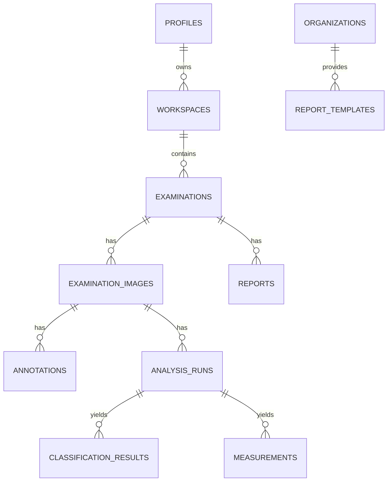

# Modèle de données

Persistance : Supabase (PostgreSQL + Storage). Les types TypeScript miroirs
de la base sont dans `client/src/lib/db/types.ts`.

## Tables

| Table | Rôle | Clé |
|---|---|---|
| `profiles` | Profil utilisateur (display_name, ui_preferences). | `id` = auth.uid() |
| `workspaces` | Espaces de travail. | `id`, `owner_id` |
| `examinations` | Examens (nom, modalité, archivé). | `id`, `workspace_id` |
| `examination_images` | Images d'un examen (storage_path, metadata, display_state). | `id`, `examination_id` |
| `annotations` | Annotations/forme dessinées. | rattachées à l'image |
| `analysis_runs` | Un run d'analyse par source (classification, gradcam, opencxr, anatomie...). | rattaché à l'image |
| `classification_results` | Résultats de classification. | rattachés à `analysis_runs` |
| `measurements` | Mesures (radius, landmarks, unités, incertitude...). | rattachées à l'image/run |
| `reports` | Rapports générés/validés. | rattachés à l'examen |
| `organizations` | Organisations (logo, signature). | `id` |
| `report_templates` | Modèles de rapports. | `id`, organisation |

## Relations principales

## Sécurité (RLS)

Tous les accès passent par des politiques RLS basées sur `auth.uid()` :

- un utilisateur ne lit/écrit que ses propres espaces de travail ;
- la fonction `owns_workspace(ws_id)` vérifie l'appartenance.

La clé `service_role` est interdite côté frontend ; seule la clé publiable
(`VITE_SUPABASE_PUBLISHABLE_KEY`) est utilisée.

## Storage

Les fichiers binaires d'images sont stockés dans des buckets Supabase
(`storage_path` référencé dans `examination_images`). Le handler de rendering
PNG et les data-URL ne sont pas persistés en base.

## Local vs Supabase

- Supabase est la source de vérité des données métier.
- `localStorage` ne contient que l'UI, les récents et le cache.
- Si Supabase n'est pas configuré, l'application fonctionne en mode local
  (dégradé) avec les mêmes repositories.