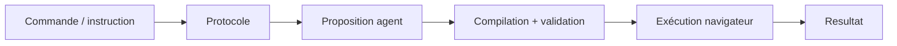

# Fonctionnalité : Agent de workspace (IA)

## Objectif

Transformer une instruction utilisateur en actions validées, exécutées sur le
workspace, via un LLM (Gemini) et un protocole strict.

## Flux

## Entrées

- Instruction libre (via `/ai/turn`, `/ai/plan`) ou commande explicite
  (`/commands/parse`, `/commands/catalog`).
- Manifeste du workspace (images, mesures, annotations).
- Contexte d'analyse (anatomie, pathologies).

## Traitement

1. Gemini `workspace_agent` propose un `AgentProposal` : intention, message
   assistant, sources de preuves, actions génériques.
2. `compile_agent_proposal` attribue ids/ordres/cibles implicites et valide
   chaque payload (`workspace_protocol.py`) — aucune exécution partielle.
3. Erreurs LLM / JSON invalide → `fallback_agent_turn` (renvoi lisible WARNING).

## Sorties

- `AgentTurnResponse` : intention, message, validations, warnings, plan.
- `ActionPlan` validé exécutable par le navigateur.

## Fichiers principaux

- `server/workspace_agent.py`, `workspace_agent_prompt.py`,
  `workspace_protocol.py`, `workspace_commands.py`, `workspace_store.py`
- `server/agent_context.py` (contexte anatomique)
- `client/src/lib/workspaceProtocol.ts`, `workspaceApi.ts`, `aiTransaction.ts`

## Limites

- Nécessite `GEMINI_API_KEY` ; sinon plan rejeté / fallback.
- Le palier gratuit Gemini n'autorise pas les données patient réelles en prod.
- Le store workspace est en mémoire (sessions temporaires).