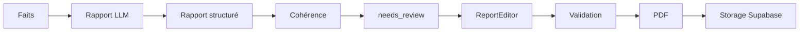

# Fonctionnalité : Rapports

## Objectif

Générer un rapport radiographique structuré à partir des faits d'analyse, le
revoir, le valider et l'exporter en PDF.

## Flux

## Quatre couches

- **Report data** : `client/src/lib/reports/engine.ts`, `findings.ts`,
  `clinicalContext.ts` (faits, contexte clinique).
- **Report template** : `report_schemas.py` (serveur), modèles DB.
- **Report rendering** : `report_renderer.py` (texte HGG), `client` editor.
- **Report export** : `pdfExport.ts` / `radioExport.ts`, envoi Storage.

## Entrées

- Résultat de classification (`/radiography/predict`).
- Contexte patient / clinique.
- Template et organisation.

## Traitement (serveur `/radiography/report`)

1. Construction des faits cliniques (`build_clinical_facts`).
2. Appel Gemini pour le rapport structuré (6 champs).
3. `check_coherence` → `needs_review`.
4. Rend le texte final (`render_report_text`).
- `503` si Gemini indisponible.

## Sorties

- Rapport structuré validé ou à revoir.
- Horodatage de validation, signature.

## Fichiers principaux

- `shared/llm/prompt.py`, `report_renderer.py`, `report_schemas.py`, `coherence_check.py`
- `client/src/lib/reports/`
- `client/src/components/ai/ReportEditor.tsx`

## Limites

- Dépend de Gemini.
- Exemples few-shot à valider par un praticien avant usage réel.