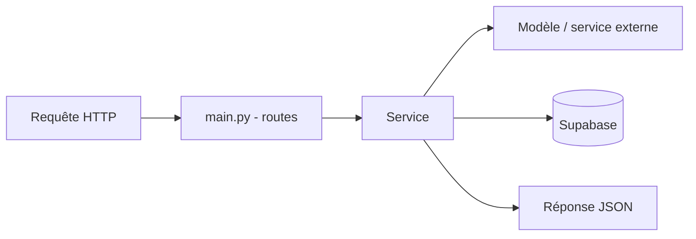

# Server

API FastAPI (Uvicorn, port 8000). Point d'entrée : `server/main.py`.

## Démarrage

```bash
cd server
pip install -r requirements.txt
uvicorn main:app --reload --port 8000
```

Le serveur démarre même sans clés ni modèles : `GET /health` expose l'état
réel (modèles, Gemini, opencxr).

## Architecture



`paths.bootstrap_all()` ajoute au `sys.path` les dossiers `scripts/` dont le
serveur dépend (training radiographie, shared/llm, running, radiography), avant
tout import métier.

## Modules

| Fichier | Rôle |
|---|---|
| `main.py` | Routes FastAPI, orchestration, modèles de réponse. |
| `config.py` | Configuration (dataclasses + env vars). |
| `paths.py` | Ajout des chemins `scripts/` au `sys.path`. |
| `model_registry.py` | Chargement de l'ensemble radiographique et de Gemini. |
| `pathology_service.py` | Détection pathologies (backend Neuro distant). |
| `anatomy_service.py` | Segmentation CXAS (chargement paresseux). |
| `chexmask_service.py` | Landmarks HybridGNet (moteur partagé). |
| `dicom_service.py` | Parsing DICOM, pseudonymisation, rendu PNG. |
| `sorter_service.py` | Client HTTP du microservice opencxr. |
| `gradcam_service.py` | Génération de la Grad-CAM de l'ensemble. |
| `workspace_agent.py` | Agent Gemini : intention, propositions, plan. |
| `workspace_protocol.py` | Contrat strict des actions et validation. |
| `workspace_commands.py` | Catalogue de commandes explicites. |
| `workspace_store.py` | Sessions workspace temporaires et audit. |
| `workspace_agent_prompt.py` | Prompt système de l'agent. |
| `agent_context.py` | Construction du contexte d'anatomie. |
| `gemini_client.py` | Client LLM pour rapports / transcription. |
| `three_d_service.py` | Backend 3D (hors périmètre actif). |
| `chexmask/` | Paquet de landmarks et mesures HybridGNet. |

## Route (vue générale)

Voir `api.md` pour la référence exhaustive. Familles :

- `GET /health` — état du serveur.
- `/radiography/*` — prédiction d'ensemble et génération de rapport.
- `/dicom/parse` — parsing et rendu DICOM.
- `/voice/transcribe` — transcription vocale via Gemini.
- `/workspace/*` — sessions, analyse, opencxr, gradcam, anatomie,
  pathologies, agent IA, 3D.

## Service view (flux)

`Request → Router → Service → Modèle/externe → Response`. Les services
distants (opencxr, Neuro, 3D) sont joint par HTTP et exposent des erreurs
traduites en `503` / `502` (fail-closed).

## Configuration et erreurs

- Configuration via dataclasses + variables d'environnement (voir
  `configuration.md`).
- Erreurs levées par les services traduites en `HTTPException` dans `main.py`
  (404 introuvable, 422 invalide, 503 indisponible, 502 externe en échec).