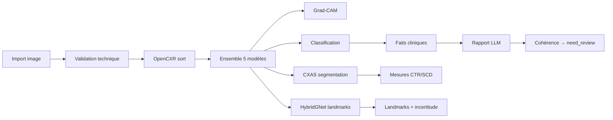
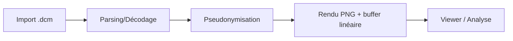
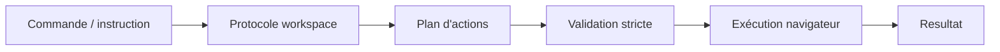
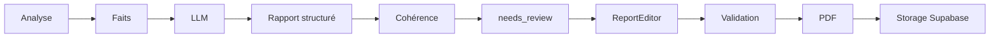

# Workflows

Flux métier réels, issus du code.

## Workflow radiographie

Ordre effectif côté client (`App.tsx` et `WorkspaceProvider`) :

1. À l'ouverture d'un examen radiographique, chaque image compatible reçoit une
   classification (ensemble) et un tri opencxr, une fois par examen.
2. L'analyse anatomique (CXAS puis HybridGNet, jamais en parallèle) est lancée
   au chargement de chaque image, sauf si l'examen a déjà été entièrement
   évalué.
3. La détection pathologies (backend Neuro) est lancée sur chaque image
   compatible, indépendamment des gardes locales.

## Workflow DICOM

Les DICOM ne sont pas persistés ; un pseudonyme temporaire sert aux contrôles
de cohérence. Le Patient ID/Name ne quitte jamais le serveur en clair.

## Workflow agent IA

Gemini produit une proposition ; le serveur compile et valide chaque action
contre le manifeste avant toute exécution. Toute invalidité annule le lot
(no partial execution).

## Workflow rapport

## Workflow persistance

Les résultats d'analyse sont persistés par run dans `analysis_runs`/
`classification_results`/`measurements` et rattachés à une image. Les rapports
vivent dans `reports`. Voir `data-model.md`.